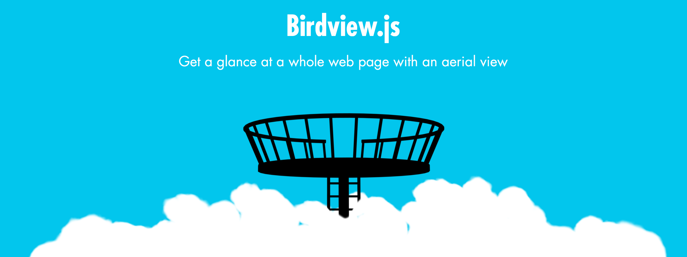

  

# Birdview.js

Get a glance at a whole web page with an aerial view.

## Demo & Documentation

Visit [**achrafkassioui.com/birdview**](https://www.achrafkassioui.com/birdview/).

## Known Issues

- In Mobile Safari, a fixed element with `backdrop-filter` can end up out of place after Birdview is disabled with a scroll. The same fixed elements without `backdrop-filter` stay in place.

## Change Log

### 2.2.1

- Fixed flashing overlay when birdview is disabled with a scroll in Mobile Safari.
- Fixed the Birdview button position after Birdview is disabled with a scroll in Mobile Safari.

### 2.2.0

- New `adaptive_button` setting: the button turns light-on-dark over dark content. On by default.

### 2.1.1

- Improved pinch on touch devices. Pinching out always uses the browser's zoom. Pinching in triggers Birdview only when the gesture starts on a page at its normal 1:1 scale.

### 2.1

- New `fade_fixed` setting: elements with `position: fixed` are faded out during Birdview. Can be turned off.
- New `margin` setting: space between the window's edges and the overlay. The page shrinks to fit inside the overlay.  `zoom_when_fits` is gone.
- The margin around the overlay prevents Safari UI from flickering and changing color to match the overlay background.
- Various fixes.

### 2.0

This is a major update with a lot of fixes and improvements.

- Birdview no longer wraps the page in its own elements. It leaves the page as it is until it's turned on, then scales the `body`.
- Birdview updates automatically whenever the window resizes, the device rotates, or the document content changes.
- Zoom is now spring-based instead of easing-based. The `speed` and `easing` settings are replaced by `stiffness`.
- A top margin on the first element no longer offsets the zoom, and pages wider than the window fit too.
- Birdview always zooms: a page that already fits is zoomed to 90% and centered (new setting `zoom_when_fits`). The "page fits" bounce animation is gone.
- Elements with `position: fixed` stay on the zoomed page where the window was, and zoom out with it.
- `callback_end` now runs once the page is back to normal, zoomed back in, and the callbacks always come in pairs.
- The keyboard shortcut ignores Cmd, Ctrl, Alt and Shift, held keys, and typing in fields.

### 1.6

- `birdview.css` update.

------

### 11 May 2019

- Core: `{passive: false}` event listeners are back. They are required for pinch gestures to work on Mobile Safari.
- UI: Birdview button is now enabled by default.
- CSS: Changed default ID for the Birdview button and overlay.

### 18 March 2019

- UI: added a setting to customize the text of the Birdview button.

### 17 March 2019

- Core: removed `{passive: false}` from touch events listeners. `{passive: false}` event listeners make custom pinch gestures easier to perform on Chrome for Android (see [Scrolling intervention](https://developers.google.com/web/updates/2017/01/scrolling-intervention)), but they also make Birdview interfere with the native zoom.
- Core: removed the option to show custom messages on screen for mobile debugging. That option has spun off and became a separate plugin: [Showlog.js](https://www.achrafkassioui.com/showlog/).

### 7 February 2019

- Core: focused elements are preserved after Birdview's initialization.

### 21 January 2019

- UI: fixed the breadcrumb navigation URLs of the Birdview overlay.

### 6 February 2018

- UI: if the page already fits into the viewport, Birdview plays a bounce animation. Requires support for Web Animations API.

### 1 February 2018

- Core: elements with `position:fixed` no longer lose their fixed positioning after calling Birdview. See blog post [Position fixed and CSS transforms](https://www.achrafkassioui.com/blog/position-fixed-and-css-transforms/).

### 23 January 2018

- API: improved and documented logging on touch devices.

### 18 January 2018

- CSS: additional reset styles in `birdview.css` for uniformity across web pages.

### 4 September 2017

- UI: the keyboard shortcut was disabled if any `input` element was in focus. Now only `input` elements of type `text` disable the keyboard shortcut.

### 15 July 2017

- CSS: additional reset styles in `birdview.css` for uniformity across web pages.

### 28 May 2017

- API: simplified settings names.
- CSS: simplified the default font stack in `birdview.css`, and added `:active` and `:focus` states to all clickable elements.
- Accessibility: added focus priority to the Birdview overlay when Birdview is active.

## License

Birdview.js is published under the [GNU General Public License](https://www.gnu.org/licenses/gpl-3.0.en.html).
